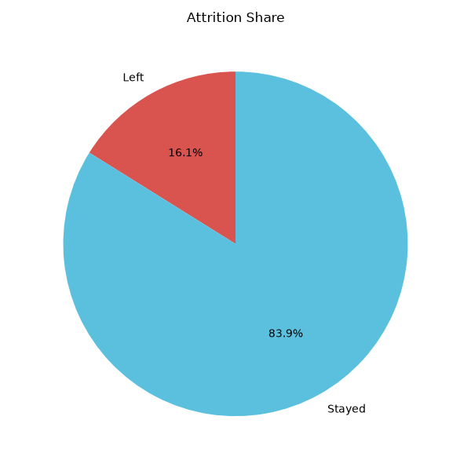
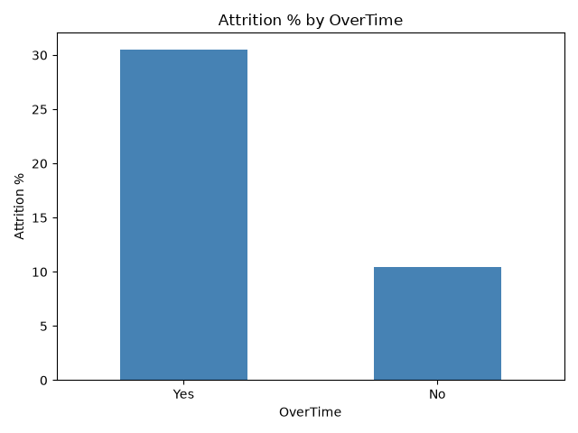
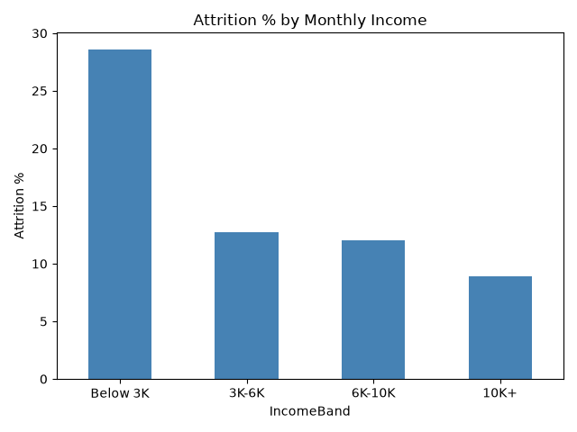
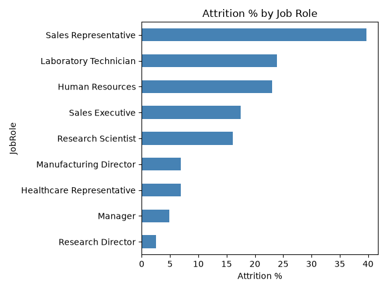
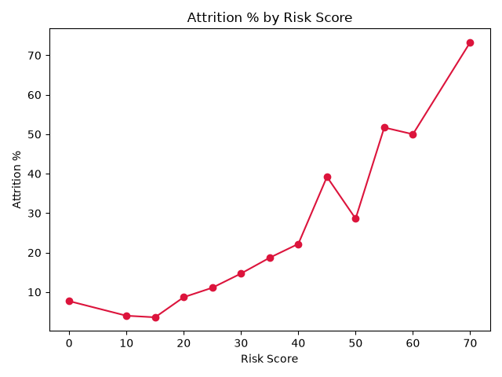

# Employee Attrition Analysis (HR) - Python

Analysis of 1,470 employees in Python to find out **why employees leave the company and which current employees are most likely to leave next**.

---

## 1. Business problem

Every employee who leaves costs the company money: hiring, training and lost work. HR wants to know:

- How many employees are leaving?
- Which departments, roles and types of employees leave the most?
- Which factors (overtime, salary, satisfaction, distance) are linked to leaving?
- Which current employees should HR talk to first?

---

## 2. Data

- **Source:** Kaggle - IBM HR Analytics Employee Attrition
- **File:** [`WA_Fn-UseC_-HR-Employee-Attrition_1.xlsx`](WA_Fn-UseC_-HR-Employee-Attrition_1.xlsx)
- **Size:** 1,470 employees, 35 columns
- **Target column:** `Attrition` (Yes = employee left)

| Key column | Meaning |
|---|---|
| Department, JobRole | Where the employee works |
| Age, MaritalStatus | Personal details |
| MonthlyIncome | Monthly salary |
| OverTime | Yes = works overtime |
| JobSatisfaction | 1 = Low, 2 = Medium, 3 = High, 4 = Very High |
| DistanceFromHome | Distance between home and office |

---

## 3. Tools and Python skills

**Tools:** Python, VS Code

**Libraries:** pandas, matplotlib

**Skills used:**
- Loading Excel data with `read_excel`
- Creating new columns (`Left` = 1 if the employee left)
- `groupby` + `agg` (works like SQL `GROUP BY`)
- `pd.cut` to create groups (age, income, distance)
- `map` to convert numbers into labels (job satisfaction)
- `reindex` and `sort_values` to order results
- Filtering with multiple conditions
- Building a weighted **risk score**
- Charts: bar, horizontal bar, pie and line charts

Full code: [`attrition.py`](attrition.py)

---

## 4. Steps

1. Loaded the Excel file into pandas
2. Created a `Left` column (1 = left, 0 = stayed) to calculate attrition %
3. Created groups for age, monthly income, distance and job satisfaction
4. Answered 9 business questions with tables and charts
5. Built a risk score from the 5 strongest warning signs
6. Checked that a higher score really means a higher attrition rate
7. Saved a list of the top 10 high-risk current employees for HR

---

## 5. Business questions and results

| # | Question | Result |
|---|---|---|
| Q1 | What percentage of employees left? | **16.1%** (237 of 1,470) |
| Q2 | Which department has the highest attrition? | **Sales 20.6%**, HR 19.0%, R&D 13.8% |
| Q3 | Do employees who work overtime leave more? | **Overtime 30.5%** vs no overtime 10.4% |
| Q4 | Which age group leaves the most? | **Age 18-29: 27.9%**; age 40-49: only 9.7% |
| Q5 | Does monthly income affect attrition? | **Below 3K: 28.6%**; 10K+: only 8.9% |
| Q6 | Which job role has the highest attrition? | **Sales Representative 39.8%**; Research Director only 2.5% |
| Q7 | Does job satisfaction affect attrition? | **Low 22.8%** vs Very High 11.3% |
| Q8 | Do single employees leave more than married ones? | **Single 25.5%** vs Married 12.5% and Divorced 10.1% |
| Q9 | Do employees who live far away leave more? | **21-29: 22.1%** vs 1-5: 13.8% |
| Q10 | Which current employees are at high risk? | Risk score 70 = **73.3%** attrition vs score 0 = 7.7%; top 10 listed |

---

## 6. Risk score (Q10)

Each employee gets points for every warning sign found in Q3-Q9:

| Warning sign | Points |
|---|---|
| Works overtime | 20 |
| Low or medium job satisfaction (1-2) | 15 |
| Monthly income below 5,000 | 15 |
| Lives more than 10 away | 10 |
| Age below 35 | 10 |
| **Maximum score** | **70** |

**Does the score work?** Yes. The higher the score, the more employees left:

| Risk score | Attrition % |
|---|---|
| 0 | 7.7% |
| 30 | 14.7% |
| 45 | 39.2% |
| 55 | 51.7% |
| 70 | **73.3%** |

The top 10 current employees with the highest score are saved in [`high_risk_employees.csv`](high_risk_employees.csv) for HR.

---

## 7. Key insights

1. **About 1 in 6 employees left** the company (16.1%).
2. **Overtime is the strongest driver.** Employees who work overtime leave **3x more** than others.
3. **Low pay leads to leaving.** Employees earning below 3K leave more than **3x as often** as those earning 10K+.
4. **Young employees leave the most.** Almost 28% of employees aged 18-29 left.
5. **Sales Representatives are the highest-risk role.** About 4 in 10 left.
6. **Single employees leave 2x more** than married employees.
7. **Unhappy employees and long commutes** both increase attrition.
8. **The risk score works.** Employees with the highest score had a **73% attrition rate**, almost 10x more than those with a score of 0.

---

## 8. Recommendations

1. **Reduce overtime** through better workload planning, or pay extra for it.
2. **Review salaries** for low-paid employees, especially in entry-level roles.
3. **Create a retention plan for Sales Representatives** and Laboratory Technicians.
4. **Support young employees** with mentoring and clear career growth.
5. **Run regular satisfaction surveys** and act quickly on low scores.
6. **Offer flexible or remote work** to employees who live far away.
7. **HR should meet the 10 high-risk employees first** and review the list every month.

---

## 9. Charts

